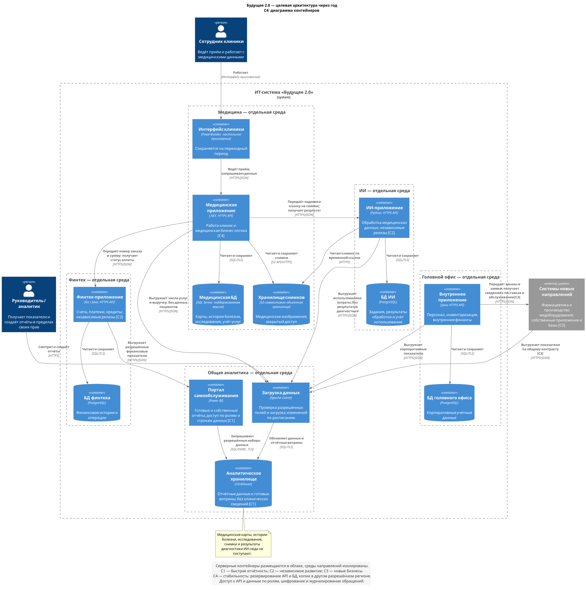

# Задание 1. Целевая архитектура

[Открыть диаграмму](./architecture.svg) · [Исходник PlantUML](./architecture.puml)

## Архитектура через год

Сейчас DWH хранит данные всех направлений, выполняет бизнес-логику и обслуживает отчёты. Предлагается выделить приложения и базы направлений, а для отчётности создать отдельное аналитическое хранилище. Серверная часть каждого направления размещается в своей облачной среде.

| Направление | Приложение и данные |
| --- | --- |
| Медицина | Медицинское API на .NET, БД на поддерживаемой версии SQL Server, снимки в закрытом S3-хранилище. Временный интерфейс — PowerBuilder. |
| Финтех | Существующие сервисы на Go/Java и отдельная PostgreSQL для счетов, платежей и кредитов. |
| ИИ | Существующие сервисы на Python, PostgreSQL для заданий и результатов. Снимки доступны по временным ссылкам. |
| Головной офис | Приложение на Java и PostgreSQL для персонала, запасов, закупок и внутренних финансов. |

Команда направления отвечает за своё приложение, данные и API. Прямого доступа к чужим базам нет. Приложения показаны укрупнённо: делить каждое из них на микросервисы пока не требуется.

SQL Server сохраняется для медицины, чтобы не совмещать перенос бизнес-логики со сменой СУБД. Для остальных баз выбран PostgreSQL. PowerBuilder постепенно переводится на медицинское API; полная замена экранов в первый год не нужна.

## Отчётность и новые направления

Разрешённые выгрузки поступают через Apache Camel в ClickHouse. Здесь хранятся данные для отчётов и готовые витрины: выручка, число услуг, финансовые показатели и расходы. Правила лечения, кредитования и обработки ИИ остаются в приложениях направлений.

Camel сохраняется как знакомый инструмент загрузки. Он проверяет поля и формат выгрузок, загружает изменения по расписанию и повторяет загрузку при ошибке. Повторная отправка той же записи не должна создавать дубль: используются идентификатор записи и её версия. Для начала выбрано обновление раз в час, частоту нужно подтвердить на первом этапе проекта.

Power BI становится порталом самообслуживания. Пользователи открывают готовые отчёты и создают свои на доступных наборах данных. Для этого выдаётся право Build на модель, а в рабочей области с общей моделью сохраняется роль Viewer. Доступ к строкам ограничивается RLS; роли с правом изменения общей модели обычным пользователям не выдаются. Это соответствует [правилам доступа Power BI](https://learn.microsoft.com/en-us/fabric/security/service-admin-row-level-security). В отчётах показывается время обновления данных.

**Медицинские карты, истории болезни, результаты исследований, снимки и результаты диагностики ИИ в ClickHouse и Power BI не передаются.** Из медицины поступают только административные показатели без данных пациентов, из ИИ — использование и затраты. Для каждой выгрузки задаётся список разрешённых полей.

Фармацевтика и производитель оборудования подключаются через API и выгрузки. Для нового направления нужны адаптер, таблицы, права и отчёты. Его бизнес-логика остаётся в собственных системах. Общие показатели и идентификаторы организаций согласуются с головным офисом.

## Бизнес-сценарии

Обозначения С1–С4 нанесены на диаграмму.

| Сценарий | Что обеспечивает архитектура |
| --- | --- |
| С1. Быстрая отчётность | Отдельный ClickHouse и готовые витрины сокращают время расчётов. Power BI позволяет собирать отчёты без каждой новой доработки разработчиками. |
| С2. Независимое развитие финтеха и ИИ | Собственные приложения, базы и среды позволяют выпускать изменения и добавлять ресурсы отдельно. |
| С3. Подключение новых бизнесов | API и адаптеры выгрузок позволяют включать компании в экосистему без новой бизнес-логики в DWH. |
| С4. Стабильность клиник и банка | Отчёты не нагружают рабочие БД. Критичные API работают в нескольких экземплярах, у БД есть реплики и переключение при отказе. |

Доступ к медицинским и финансовым данным ограничивается ролями и протоколируется. Данные шифруются при передаче и хранении. Копии размещаются в другом разрешённом регионе; восстановление проверяется до переключения рабочих систем. Требования к размещению данных и допустимому времени простоя уточняются с ИБ и бизнесом.

## Проблемы и приоритеты

Используется MoSCoW: Must — обязательно в первый год, Should — после основной части, Could — при наличии времени, Won't — за рамками года.

| Проблема | Влияние на бизнес | Приоритет | Решение |
| --- | --- | --- | --- |
| Отчёты строятся часами, много преобразований на сотнях терабайт | С1: задерживаются управленческие решения. С4: отчёты конкурируют с рабочими операциями за ресурсы. | **Must** — скорость решений и доступность услуг | Отдельная аналитика, загрузка изменений и готовые витрины. |
| Бизнес-логика разных направлений находится в DWH | С2, С3: запуск новых продуктов и приобретённых компаний зависит от изменений общей системы. | **Must** — time-to-market и выручка | Приложения и базы доменов, обмен через API. |
| Медицинские, финансовые и корпоративные данные хранятся вместе | С1, С4: при открытии самообслуживания можно выдать лишний доступ. | **Must** — защита данных клиентов | Разделить данные, проверить роли и разрешённые поля выгрузок. |
| Много кастомизаций BI, портал самообслуживания ещё нужно реализовать | С1: новые срезы требуют доработок. | **Must** — прямое требование бизнеса на год | Подключить Power BI к витринам, настроить создание отчётов и права. |
| Центральная система основана на SQL Server 2008 | С3, С4: сложнее расширять и поддерживать систему, от общего узла зависят несколько направлений. | **Must** — непрерывность работы клиник и банка | Обновить БД, перенести серверные части в облако, настроить резервирование. |
| Интеграции зависят от общей старой ESB | С2, С3: изменения приходится согласовывать между командами. | **Should** — ускорение подключения новых компаний | Выделить адаптеры, согласовать API; Camel оставить для загрузок. |
| PowerBuilder связан с логикой в DWH | С4: изменение БД затрагивает работу операторов клиник. | **Should** — снижение риска при миграции | Перевести основные операции на медицинское API. |

Утечки и отказы в кейсе не описаны: здесь это риски архитектуры. Первыми решаются задачи Must, поскольку без них нельзя запустить портал и разделить направления.

**Could:** перенести дополнительные редко используемые отчёты после основных.

**Won't:** полностью переписать PowerBuilder и заменить все легаси-модули за год. Кейс допускает их временное сохранение; замена всех систем увеличит срок запуска портала.
