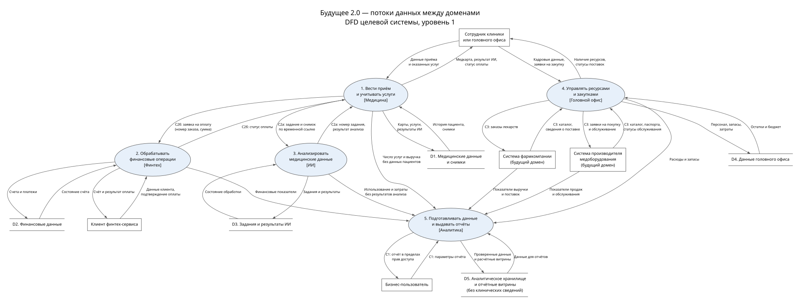

# Задание 2. Домены и потоки данных

[Открыть DFD](./dfd.svg) · [Исходник Graphviz](./dfd.dot)

## Разделение на домены

У каждого рабочего домена есть своё приложение, данные и ответственная команда. Бизнес-правила выполняются в приложениях, аналитическое хранилище используется для отчётов. Состав приложений показан в [задании 1](../Task1/README.md).

| Домен | Ответственность и данные | Причина выделения |
| --- | --- | --- |
| Медицина | Приёмы, пациенты, карты, истории болезни, исследования и учёт услуг | Клиника развивает свои процессы отдельно от банковских продуктов. |
| Финтех | Счета, платежи, кредиты, финансовая история | Новый финансовый продукт не требует изменения медицинской БД и процедур DWH. |
| ИИ | Модели, задания, результаты анализа и учёт использования | Модели обновляются, вычислительные ресурсы увеличиваются независимо от клиники. |
| Головной офис | Персонал, запасы, закупки и внутренние финансы | Общие хозяйственные процессы отделены от лечения и платежей. |
| Фармацевтика | Каталоги препаратов, заказы и поставки | У партнёров собственные системы и правила работы. |
| Медоборудование и электроника | Каталог оборудования, поставки, паспорта устройств и обслуживание | Обслуживание оборудования отличается от работы с лекарствами. |
| Аналитика | Разрешённые отчётные данные, показатели, витрины и права пользователей | Общая отчётность не участвует в проведении приёма, платежа или ИИ-анализа. |

Фармацевтика и медоборудование — будущие домены. Для них приняты сценарии поставки лекарств, покупки и обслуживания оборудования. На DFD их системы показаны внешними сущностями, без детализации внутренних баз.

## Потоки данных

Овалы на DFD — процессы, прямоугольники — пользователи и внешние системы, две горизонтальные линии — хранилища. Стрелки показывают передаваемые данные. D1 объединяет медицинскую БД и снимки в одно логическое хранилище.

**С1. Отчётность.** Домены передают разрешённые показатели в аналитику (5). После проверки обновляются витрины D5. Пользователь выбирает срезы и получает отчёт в пределах своих прав. Загрузка через Camel и портал Power BI здесь объединены в один процесс. Данные обновляются раз в час, в отчёте видно время обновления.

**С2а. ИИ в клинике.** Медицинское приложение (1) сохраняет данные приёма в D1 и передаёт ИИ-домену (3) задание и временную ссылку на нужный снимок. ИИ сохраняет результат в D3 и возвращает его по номеру задания. Медицинское приложение записывает результат в карту пациента, врач получает его через интерфейс клиники. Доступ ко всей медицинской базе ИИ не нужен.

**С2б. Новый финтех-сервис.** При добавлении способа оплаты медицинский домен передаёт финтеху (2) номер заказа и сумму. Клиент подтверждает платёж; финтех сохраняет операцию в D2 и возвращает статус. Правила оплаты меняются внутри финтеха. При сохранении формата API медицинская система не меняется. Диагнозы и результаты исследований в этот обмен не входят, DWH в платеже не участвует.

**С3. Подключение партнёров.** Головной офис (4) отправляет фармкомпании заказ лекарств и получает сведения о поставке. Производителю оборудования передаётся заявка на покупку или обслуживание, в ответ приходят паспорт устройства и статус работ. Офис хранит свой учёт в D4, партнёры — в собственных системах. Каждый партнёр отдельно передаёт согласованные показатели в аналитику.

**Медицинские карты, истории болезни, снимки, результаты исследований и диагностики ИИ в D5 и портал не передаются.** Из медицины поступают количество услуг и выручка без данных пациентов, из ИИ — только использование и затраты. Состав полей каждой выгрузки ограничен заранее.

## Польза для бизнеса

- Команды выпускают изменения своих продуктов отдельно, без общего релиза DWH.
- Приём, платёж и ИИ-анализ работают в доменах. Задержка аналитики не должна останавливать эти операции.
- Новая компания подключается через API, адаптер и отчётные таблицы, сохраняя свою бизнес-логику.
- Собственные базы и облачные среды позволяют увеличивать ресурсы направлений независимо.

Прямых запросов к чужим рабочим БД нет. Изменения API согласуются с получателями. Для сводных отчётов владельцы доменов и головной офис определяют единый смысл показателей и идентификаторы организаций. Текущий статус платежа или ИИ-задания запрашивается у рабочего домена, поскольку аналитические данные поступают с задержкой.
