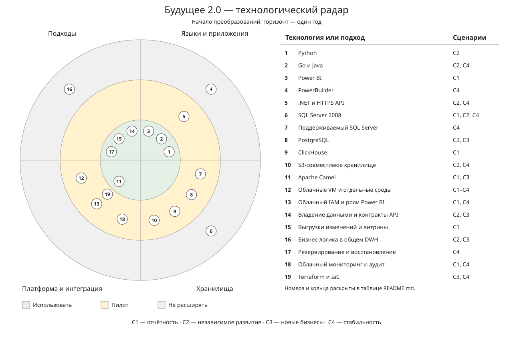

# Задание 3. Технологический радар и роадмап

[Открыть радар](./radar.svg) · [Роадмап на год](./roadmap.md)

## Радар

Кольца показывают решение на начало проекта:

- **Использовать (Adopt)** — сохранить или взять за основу.
- **Пилот (Trial)** — проверить перед промышленным запуском.
- **Не расширять (Hold)** — поддерживать до замены, новые функции не добавлять.

Сценарии те же, что в [задании 1](../Task1/README.md): **С1** — отчётность, **С2** — независимое развитие, **С3** — новые бизнесы, **С4** — стабильность сервисов.

| № | Технология или подход | Сейчас | Кольцо | Решение и сценарии |
| --- | --- | --- | --- | --- |
| 1 | Python | ИИ-сервисы | Использовать | Сохранить приложения, обновлять модели внутри ИИ-домена. **С2.** |
| 2 | Go и Java | Финтех-сервисы | Использовать | Сохранить стек финтеха; Java использовать для приложения головного офиса. **С2, С4.** |
| 3 | Power BI | Отчёты поверх DWH | Использовать | Подключить новые витрины, настроить права и создание собственных отчётов. **С1.** |
| 4 | PowerBuilder | Интерфейс клиник | Не расширять | Сохранить экраны, основные операции перевести на медицинское API. **С4.** |
| 5 | .NET и HTTPS API | Новое решение | Пилот | Перенести медицинскую бизнес-логику из БД в приложение. **С2, С4.** |
| 6 | SQL Server 2008 | Общее DWH | Не расширять | Переносить данные и логику по направлениям. **С1, С2, С4.** |
| 7 | Поддерживаемый SQL Server | Новое решение | Пилот | Обновить медицинскую БД с проверкой совместимости процедур и данных. **С4.** |
| 8 | PostgreSQL | Новое решение | Пилот | Выделить БД финтеха, ИИ и офиса; команды управляют своими схемами. **С2, С3.** |
| 9 | ClickHouse | Новое решение | Пилот | Вынести аналитическую нагрузку, проверить скорость основных отчётов. **С1.** |
| 10 | S3-совместимое хранилище | Новое решение | Пилот | Хранить снимки отдельно, выдавать ИИ временные ссылки. **С2, С4.** |
| 11 | Apache Camel | Общая ESB | Использовать | Сохранить для адаптеров и загрузок; рабочие связи перевести на API. **С1, С3.** |
| 12 | Облачные VM и отдельные среды | Переезд запланирован | Пилот | Разделить среды направлений, тестовую и рабочую инфраструктуру. **С1–С4.** |
| 13 | Облачный IAM и роли Power BI | Новое решение | Пилот | Настроить служебные аккаунты, роли сотрудников и ограничения строк в отчётах. **С1, С4.** |
| 14 | Владение данными и контракты API | Новый подход | Использовать | Назначить владельцев, описать API в OpenAPI и поля выгрузок в JSON. **С2, С3.** |
| 15 | Выгрузки изменений и витрины | Новый подход | Использовать | Загружать изменения через Camel, готовить отчётные наборы в ClickHouse. **С1.** |
| 16 | Бизнес-логика в общем DWH | Текущий подход | Не расширять | Перенести правила лечения, оплаты и обработки ИИ в приложения. **С2, С3.** |
| 17 | Резервирование и восстановление | Планируется в облаке | Использовать | Несколько экземпляров API, реплики БД, копии в другом разрешённом регионе; проверка восстановления. **С4.** |
| 18 | Облачный мониторинг и аудит | Новое решение | Пилот | Метрики API, БД и загрузок, оповещения об ошибках, журналы доступа. **С1, С4.** |
| 19 | Terraform и IaC | Новое решение | Пилот | Описать VM, диски и сеть в коде для повторяемого создания сред. Учебный пример — в [Task4](../Task4/README.md). **С3, С4.** |

Новые решения переходят из пилота в эксплуатацию после проверки. Медицинские карты, истории болезни и результаты исследований остаются в медицинском и ИИ-доменах, в отчётные витрины не загружаются.
