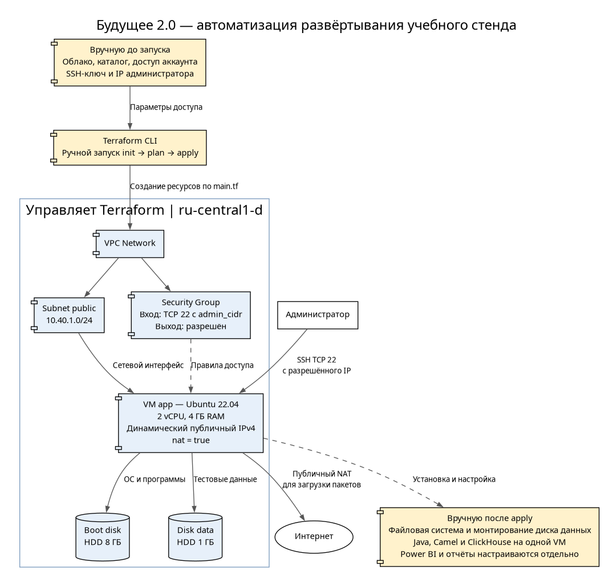
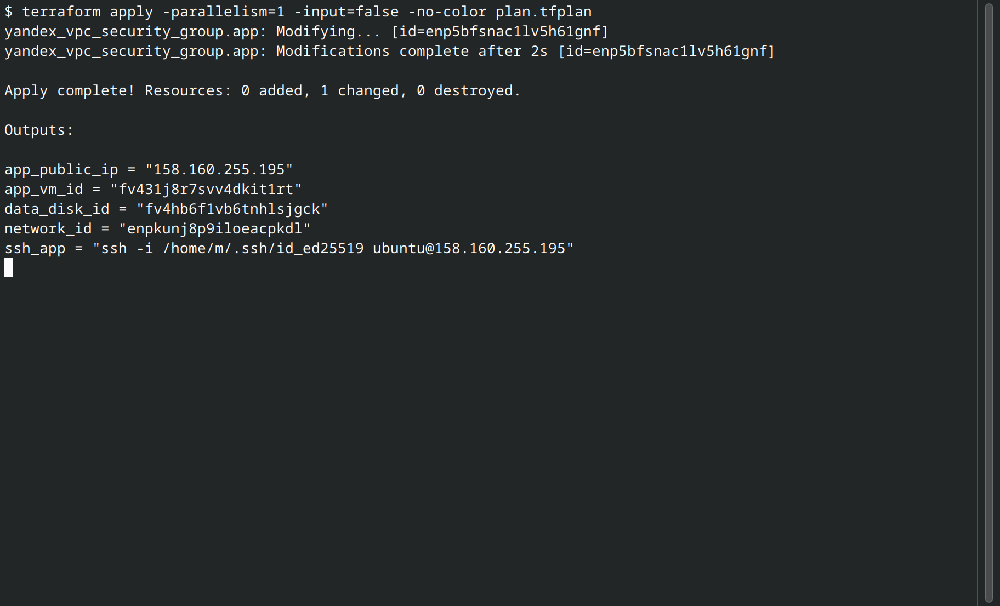

# Задание 4. Развёртывание через Terraform



[Обоснование](./justification.md) · [Исходник диаграммы](./diagram.dot)

Конфигурация создаёт учебный стенд в Yandex Cloud: VM с 2 vCPU и 4 ГБ RAM, загрузочный HDD 8 ГБ, диск данных 1 ГБ, VPC, подсеть и группу безопасности. Зона — `ru-central1-d`. Голубые компоненты создаёт Terraform, жёлтые требуют ручной подготовки или установки.

## Результат проверки

Стенд проверен на Terraform 1.13.5 и провайдере Yandex Cloud 0.236.0. Выполнены `init`, `fmt -check`, `validate`, `plan` и `apply`. После применения повторный план показал `No changes`.



Ресурсы создавались поэтапно. На скриншоте — последний успешный `apply`: обновление SSH-правила на текущий IP администратора. Поэтому результат содержит `0 added, 1 changed`; VM, диски и сеть уже созданы предыдущими запусками.

## Запуск

Нужны Terraform версии от 1.5 до 2.0 (не включая 2.0), облачный каталог с платёжным аккаунтом, права на создание ресурсов и публичный SSH-ключ.

1. Подготовить сервисный аккаунт и локальный JSON-файл авторизованного ключа по [инструкции Yandex Cloud](https://yandex.cloud/en/docs/terraform/authentication#auth-as-sa-authorized-key).
2. Проверить `terraform.tfvars`: размеры, зону, публичный IPv4 администратора с маской `/32` и путь к публичному ключу.
3. Передать доступ через окружение:

```bash
export YC_CLOUD_ID="идентификатор-облака"
export YC_FOLDER_ID="идентификатор-каталога"
export YC_SERVICE_ACCOUNT_KEY_FILE="/абсолютный/путь/service-account-key.json"
```

Вместо файла ключа можно использовать IAM-токен в `YC_TOKEN`. Выбирается один способ авторизации; секреты в Git не добавляются.

Из корня репозитория:

```bash
cd Task4
terraform init
terraform fmt -check
terraform validate
terraform plan -out=plan.tfplan
terraform apply -parallelism=1 plan.tfplan
terraform output
terraform plan
```

Если реестр провайдеров недоступен, можно настроить [официальное зеркало Yandex Cloud](https://yandex.cloud/ru/docs/tutorials/infrastructure-management/terraform-quickstart#configure-provider). Флаг `-parallelism=1` создаёт ресурсы последовательно. После успешного `apply` повторный план должен показать отсутствие изменений.

Команду SSH можно получить через `terraform output -raw ssh_app`. Дополнительный диск подключён как `/dev/disk/by-id/virtio-analytics-data`. Файловая система, монтирование, Java, Camel и ClickHouse настраиваются вручную. ClickHouse слушает localhost; снаружи открыт только SSH с IP администратора. Power BI и отчёты настраиваются отдельно.

## Удаление стенда

```bash
terraform destroy
```

Удаляется и диск с тестовыми данными. Перед удалением нужные данные следует сохранить. State, планы и каталог `.terraform` исключены из Git; локальный state нужно хранить до удаления ресурсов.
